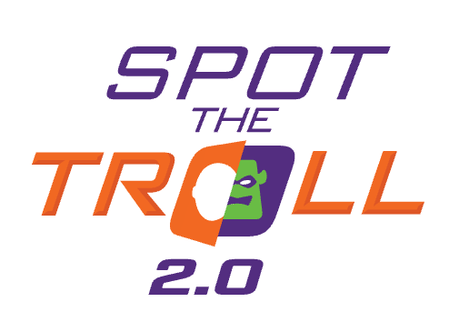
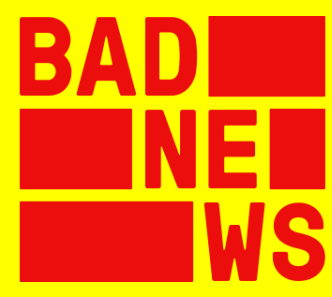

:::info
📒 [作業上傳區](https://padlet.com/teacher10_bnh9/stop-s025f5mgj4k2gpywzbk5)
:::

## 第一節 認知覺醒
### 任務1 認知科學實驗
- [Peter Wason 2-4-6 認知科學實驗](https://eurekalea.github.io/html/246game/)

### 任務2 網軍透測試
 

----

## 第二節 情緒黑客

### 任務1 快問快答
> 不需要太多思考，按你當下的心情或平時瀏覽網路的習慣「快速」回答即可
- [快問快答](https://docs.google.com/forms/d/e/1FAIpQLSeKX3izYrFIbNmVGcs3YoqllWLjZmjdBE-_ZzuLW45Plo5IqA/viewform?usp=header)

### 任務2 假新聞製造機
認知防禦的最高境界，是理解攻擊者的思維。
進入模擬器，扮演資訊操弄者。當你親自利用情緒煽動群眾、
體驗過假新聞製造流程後，你將對所有的操弄手法免疫。

---
## 第三節 新聞生產標籤
### 任務1 了解假訊息的特徵

### 為何人會被假新聞騙?
<iframe width="560" height="315" src="https://www.youtube.com/embed/h3fQgwWniK0?si=cM_fcpkyw-UzKc2Q" title="YouTube video player" frameborder="0" allow="accelerometer; autoplay; clipboard-write; encrypted-media; gyroscope; picture-in-picture; web-share" referrerpolicy="strict-origin-when-cross-origin" allowfullscreen></iframe>

### 假新聞識讀術
<iframe width="560" height="315" src="https://www.youtube.com/embed/m3gLNa-fx_w?si=pMJTk0gEVv1IKcBz" title="YouTube video player" frameborder="0" allow="accelerometer; autoplay; clipboard-write; encrypted-media; gyroscope; picture-in-picture; web-share" referrerpolicy="strict-origin-when-cross-origin" allowfullscreen></iframe>

### 任務2 大家來找碴
> 運用剛剛學會的假新聞識讀術，試著判斷以下新聞的真偽。

- [假訊息判讀挑戰](https://eurekalea.github.io/html/mygopen-test.html)

### 課程主題曲：誰在說

<iframe width="560" height="315" src="https://www.youtube.com/embed/RlXSoUnrveM?si=dEeDK_fEztxhrdQf" title="YouTube video player" frameborder="0" allow="accelerometer; autoplay; clipboard-write; encrypted-media; gyroscope; picture-in-picture; web-share" referrerpolicy="strict-origin-when-cross-origin" allowfullscreen></iframe>

誰在說？為何要說？
想讓你信，再要你做什麼？
先停一下，證據在哪？
別讓你的手，替謠言加碼。

---
參考資料：
- Vosoughi, S., Roy, D., & Aral, S. (2018). The spread of true and false news online. Science, 359(6380), 1146–1151.
- Sundar et al. (2025), Nature Human Behaviour, Sharing without clicking on news in social media
- 假訊息接種遊戲 https://inoculation.science/
- 山姆·溫伯格（Sam Wineburg）及史丹福歷史教育集團（SHEG） 「公民線上推理」（Civic Online Reasoning, COR）的教學法。
- 誰在脆上帶風向,天下雜誌 https://www.cw.com.tw/graphics/taiwan-polarization-2026/

